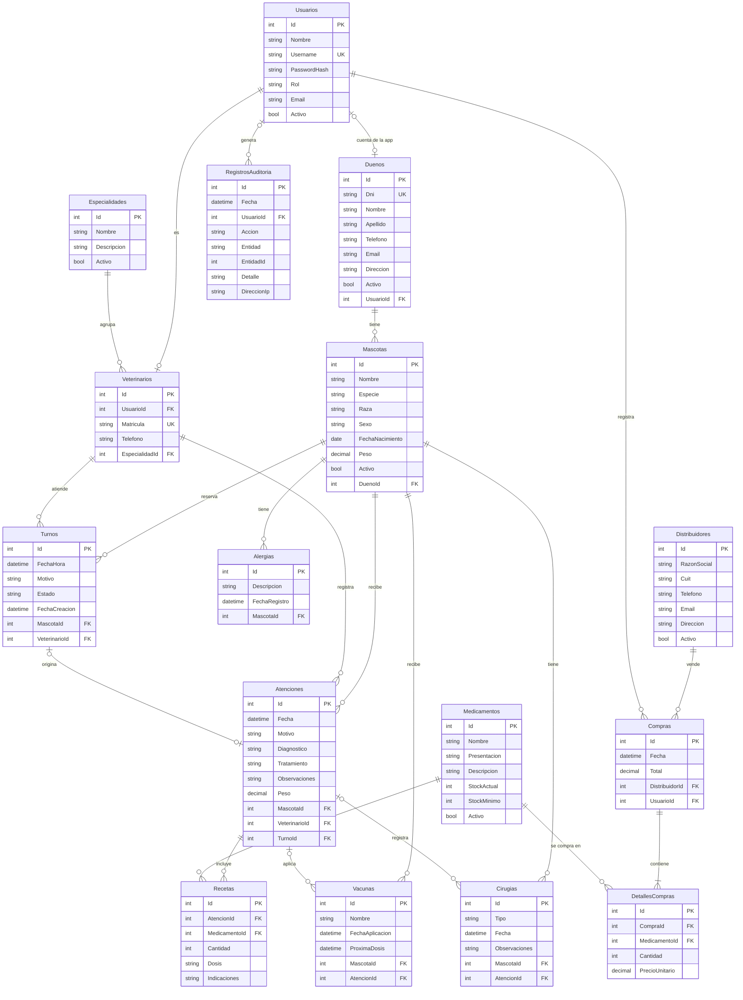

# Sistema Integral de Gestión Veterinaria – "Volki"

Sistema para una veterinaria de perros y gatos: dueños, mascotas, turnos, fichas clínicas, atenciones médicas y control de stock de medicamentos con compras a distribuidores.

## Arquitectura

```
Web (Blazor WebAssembly) ── personal: Admin, Veterinario, Recepcionista ─┐
                                                                         ├─HTTPS + JWT──> API REST ASP.NET Core (.NET 10) ──> SQL Server
App móvil (.NET MAUI Blazor Hybrid, Android) ── dueños de mascotas ──────┘
```

| Carpeta | Contenido |
|---|---|
| `VeterinariaApi/` | API REST: Entity Framework Core, JWT con roles, Serilog, auditoría, QuestPDF y MailKit |
| `VeterinariaWeb/` | Web para el personal (Blazor WebAssembly Standalone) |
| `VeterinariaMovil/` | App Android para dueños (.NET MAUI Blazor Hybrid) |

## Roles

| Funcionalidad | Admin | Veterinario | Recepcionista | Dueño (app) |
|---|---|---|---|---|
| Crear usuarios del personal | Sí | No | No | No |
| Especialidades, distribuidores, medicamentos | Sí | Ver medicamentos | No | No |
| Compras (suman stock automáticamente) | Sí | No | No | No |
| Reportes PDF y envío por correo | Sí | No | No | No |
| Auditoría y registro de errores | Sí | No | No | No |
| Registrar dueños (y su cuenta de la app) y mascotas | Sí | No | Sí | No |
| Agendar, cancelar y reprogramar turnos | Sí | No | Sí | No |
| Buscar mascota (datos básicos) | Sí | Sí | Sí | No |
| Agenda del día | No | Sí | No | No |
| Ficha clínica | Ver | Sí | No | Solo sus mascotas |
| Registrar atención (diagnóstico, tratamiento, vacunas, alergias, cirugías, recetas) | No | Sí | No | No |
| Ver turnos, historial y medicamentos recetados | No | No | No | Solo los suyos |

- La base arranca con **un solo usuario: `admin` / `admin123`** (la contraseña se convierte a hash en el primer arranque). El admin crea a los veterinarios y recepcionistas desde la web.
- La recepción crea las cuentas de los dueños (usuario y contraseña) al registrarlos.
- La web rechaza el rol Dueño y la app rechaza al personal. La seguridad real la aplica la API con `[Authorize(Roles = ...)]`; un dueño solo puede ver lo suyo porque la API filtra por el usuario del token.

## Modelo de datos (DER, 3FN)



Decisiones:
- **Baja lógica** (`Activo`) en vez de borrar: el historial clínico y las compras nunca se pierden. Ninguna relación borra en cascada.
- **Stock automático**: cada compra suma stock y cada receta lo descuenta, dentro de una transacción. Si no hay stock suficiente, la atención no se guarda.
- **Turnos sin superposición**: un veterinario no puede tener dos turnos pendientes a menos de 30 minutos.
- **Hora de Argentina** (UTC-3) en el servidor, porque el hosting puede estar en otra zona horaria.

## Endpoints principales

| Método | Ruta | Rol |
|---|---|---|
| POST | `api/Auth/Login`, `api/Auth/CambiarPassword` | Todos |
| GET/POST/PUT | `api/Usuarios` | Admin |
| GET/POST/PUT | `api/Especialidades`, `api/Veterinarios` | Personal (escritura: Admin) |
| GET/POST/PUT | `api/Duenos`, `api/Duenos/{id}/cuenta` | Admin, Recepcionista |
| GET/POST/PUT | `api/Mascotas` | Personal (escritura: Admin, Recepcionista) |
| GET/POST/PUT | `api/Turnos`, `api/Turnos/agenda`, `.../reprogramar`, `.../cancelar` | Personal |
| GET | `api/Atenciones/ficha/{mascotaId}` | Admin, Veterinario |
| POST | `api/Atenciones` | Veterinario |
| GET/POST/PUT | `api/Medicamentos`, `api/Distribuidores`, `api/Compras` | Admin (medicamentos: también Veterinario, solo lectura) |
| GET/POST | `api/Reportes/{stock\|compras\|atenciones}`, `api/Reportes/enviar` | Admin |
| GET | `api/Auditoria`, `api/Resumen` | Admin / Personal |
| GET | `api/Portal/perfil`, `.../mascotas`, `.../mascotas/{id}/historial`, `.../turnos`, `.../medicamentos` | Dueño |

## Cómo correrlo en local

1. Abrir `Veterinaria.slnx` en Visual Studio.
2. En la Consola del Administrador de paquetes (proyecto predeterminado `VeterinariaApi`): `Add-Migration Inicial` y después `Update-Database`. Se crea la base **VeterinariaDb** (separada de cualquier otra).
3. Ejecutar `VeterinariaApi` (https://localhost:7280/swagger) y `VeterinariaWeb` (https://localhost:7290).
4. Ingresar con `admin` / `admin123` y crear al veterinario y a la recepcionista.

## Despliegue

- API: MonsterASP.NET (sitio nuevo, base MSSQL nueva). `appsettings.Production.json` (no se sube a Git, ver `appsettings.Production.EJEMPLO.json`) lleva la cadena de conexión, la clave JWT y el SMTP. Las migraciones se aplican solas al arrancar.
- Web: Cloudflare Pages, con `wwwroot/appsettings.Production.json` apuntando a la URL de la API.
- App: `MauiProgram.ApiBaseUrl` apunta a la misma API.

| Qué | URL |
|---|---|
| API (Swagger) |https://veterinariavolki.runasp.net/swagger/index.html |
| Web | https://veterinariavolki.runasp.net/swagger/index.html |

## Usuarios de prueba

| Rol | Usuario | Contraseña |
|---|---|---|
| Administrador | admin | admin123 |
| Veterinario | _crear desde la web_ | |
| Recepcionista | _crear desde la web_ | |
| Dueño (app) | _crear desde Recepción → Dueños_ | |
